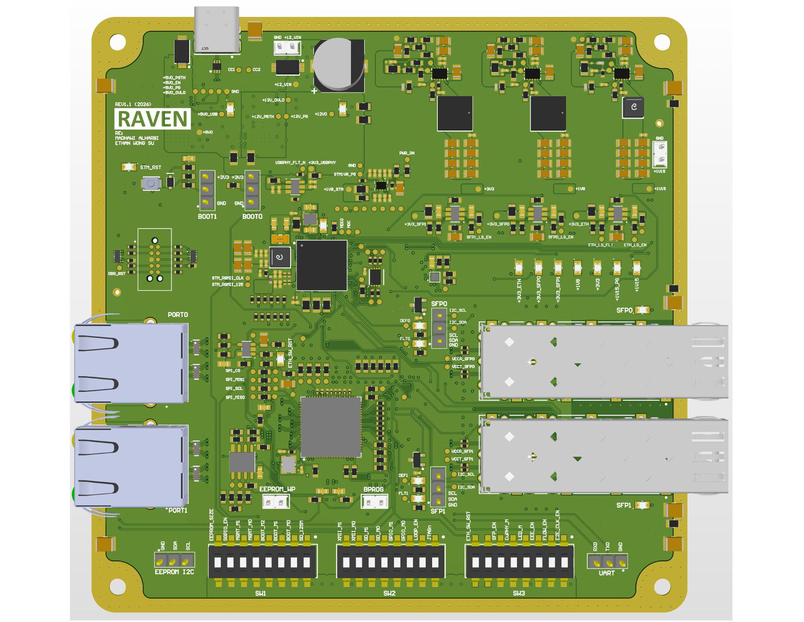

# Ethernet-to-Fiber Media Converter with Proactive Fault Detection and Redundant Failover
### Summary
The rapid growth of artificial intelligence is driving the construction of larger, faster, and more densely interconnected data centers. As network bandwidth and cable distance increase, copper interconnects experience greater electrical loss and require additional power for signal transmission and cooling. These demands increase operating costs and contribute to the environmental impact of modern computing infrastructure. Optical fiber is therefore becoming increasingly prevalent because it supports high data rates over long distances with lower transmission loss and immunity to electromagnetic interference.
Although optical fiber improves network speed and efficiency, an optical link can gradually lose operating margin because of connector contamination, fiber bending, temperature variation, component aging, or declining transceiver performance. Conventional media converters generally indicate whether a link is active but provide little ability to act on degradation before errors or complete loss of connectivity occur. This project addresses that limitation with an intelligent Ethernet-to-fiber converter that continuously monitors optical diagnostics and uses a proactive fiber-maintenance algorithm to transfer traffic to a redundant path before the active link fails.

### Explore the hardware

[](docs/pcb/README.md)

**[View the PCB gallery](docs/pcb/README.md)** — top and bottom 3D views, schematic, layer prints, layout details, routing checks and the combined design PDF. Board ordered from JLCPCB; DRC/DFM refinement is ongoing.

### Virtual GUI and CLI demo

The [PHOTON demo console](tools/demo_console/README.md) runs on a laptop without boards and provides synthetic SFP telemetry, traffic charts, fault injection, coordinated failover, VLAN state and diagnostics. Requires Python 3.10+ with no third-party packages.

```sh
cd tools
python -m demo_console serve
```

Open http://127.0.0.1:8765. From a second terminal in `tools/`, run `python -m demo_console status` or `python -m demo_console scenario fade`. Windows users may launch `tools/demo_console/start-demo.cmd` directly.

Run behavioral tests from `tools/`: `python -m unittest demo_console.test_engine -v`.

The demo is a behavioral simulation; its thresholds and proposed handshake differ from the embedded implementation. See the [firmware relationship and limitations](tools/demo_console/README.md#relationship-to-embedded-firmware) before using it as a firmware reference.

### Clone and Build Instructions
1. Clone to whatever location and open STM32CubeIDE. Open a workspace when prompted.
2. Open the Project Explorer tab (Window -> Show View -> Project Explorer)
3. File -> Import -> General -> Existing Projects into Workspace. Select the "Select root directory" option and input the root directory where the cloned repo is stored, check the box next to the name of the repo in the Projects results box, then click Finish. The project will appear in the Project Explorer.
4. Select the project in Project Explorer on left hand side.
5. Build, if error occurs try clean and build again
