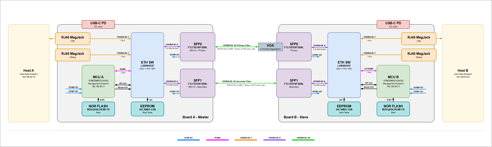
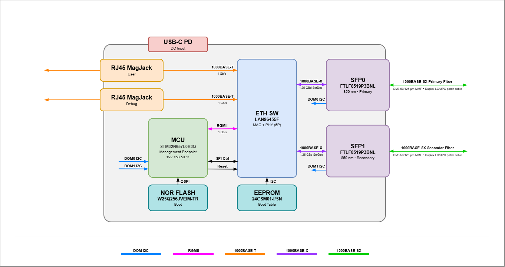
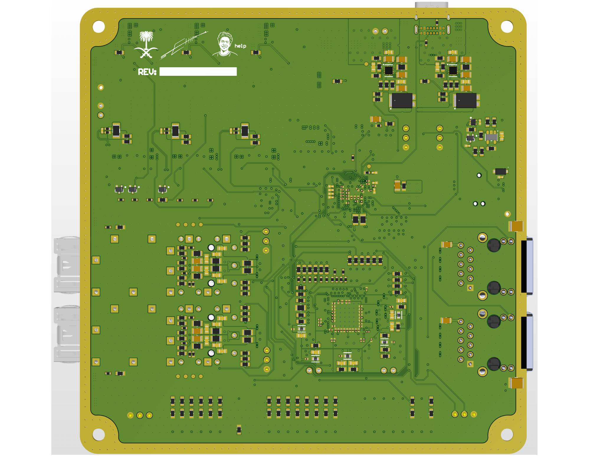

# RAVEN | Intelligent Ethernet-to-Fiber Converter

**Two optical paths. Continuous link monitoring. Coordinated failover.**

A capstone project combining a ten-layer Ethernet-to-fiber board with STM32 management and a LAN96455F Ethernet switch. The goal is to detect optical degradation and move traffic to a backup fiber path before the active link fails.

## System architecture

### Two-board link

[](docs/architecture/two-board.png)

### Inside one board

[](docs/architecture/one-board.png)

*Architecture illustrations; see the schematic and BOM for current component selections. Click either diagram for full resolution.*

**Hardware:** ordered from JLCPCB; DRC/DFM refinements ongoing.

**Laptop demo:** runnable GUI + CLI with synthetic telemetry and traffic. Hardware failover performance has not yet been measured.

[Board views](#the-assembled-board) · [Schematic & layers](#explore-the-design) · [Run the demo](#run-the-virtual-demo) · [Firmware setup](docs/FIRMWARE_SETUP.md)

## The assembled board

### Top
[](docs/pcb/exports/pcb-3d-view-1.pdf)

### Bottom
[](docs/pcb/exports/pcb-3d-view-2.pdf)

*Rendered from the supplied Altium 3D exports. Click either view for its original PDF.*

## Explore the design

| Document | What to look for |
| --- | --- |
| [Schematic — 26 pages](docs/pcb/exports/schematic.pdf) | System architecture, power conversion, switch, MCU, SFP and copper Ethernet interfaces |
| [PCB layers — 11 pages](docs/pcb/exports/pcb-layer-prints.pdf) | Board overview, signal routing, reference copper and power distribution |

## Layout details

| Area | Top | Bottom |
| --- | --- | --- |
| Ethernet switch | [View](docs/pcb/images/eth_sw_layout_top.png) | [View](docs/pcb/images/eth_sw_layout_bot.png) |
| SFP interfaces | [View](docs/pcb/images/sfp_layout_top.png) | [View](docs/pcb/images/sfp_layout_bot.png) |
| STM32 | [View](docs/pcb/images/stm_layout_top.png) | [View](docs/pcb/images/stm_layout_bot.png) |

[1.15 V buck layout](docs/pcb/images/1v15_buck_layout.png)

## Stackup, constraints and routing checks

| Evidence | Captures |
| --- | --- |
| Board and stackup | [Board statistics](docs/pcb/images/board_info.png) · [Layer stack](docs/pcb/images/stackup_manager.png) · [JLCPCB impedance calculator](docs/pcb/images/jlcpcb-impedance-2026-10-27.png) |
| Routing rules | [SE50](docs/pcb/images/rules_routing_se50.png) · [DIFF100](docs/pcb/images/rules_routing_dp100.png) · [DIFF90](docs/pcb/images/rules_routing_dp90.png) |
| Length rules | [Overview](docs/pcb/images/rules_length_matching.png) · [QSPI](docs/pcb/images/rules_length_matching_qspi.png) · [RGMII RX](docs/pcb/images/rules_length_matching_RGMII_RX.png) · [RGMII TX](docs/pcb/images/rules_length_matching_RGMII_TX.png) · [RJ45](docs/pcb/images/rules_length_matching_rj45.png) · [SFP](docs/pcb/images/rules_length_matching_sfp.png) · [USB](docs/pcb/images/rules_length_matching_usb.png) |
| xSignal results | [QSPI](docs/pcb/images/xSignals_QSPI.png) · [RGMII RX](docs/pcb/images/xSignals_RGMII_RX.png) · [RGMII TX](docs/pcb/images/xSignals_RGMII_TX.png) · [RJ45 port 0](docs/pcb/images/xSignals_RJ450.png) · [RJ45 port 1](docs/pcb/images/xSignals_RJ451.png) · [SFP](docs/pcb/images/xSignals_SFP.png) · [USB](docs/pcb/images/xSignals_USB.png) |
| JLCPCB DFM viewer | [Gerber preview](docs/pcb/images/jlcpcb_gerber_t.png) · [Wireframe preview](docs/pcb/images/jlcpcb_wireframe_t.png) |

The calculator capture is from October 27: 4-mil widths with 50-ohm single-ended and 96/92-ohm differential targets. Its ±1% calculator setting is not a manufacturing tolerance guarantee. Captures document displayed settings and results; they do not establish complete DRC/DFM closure or measured performance.

## Take the complete tour

**[Download the combined design PDF — 69 pages](docs/pcb/PHOTON_PCB_Design_Evidence.pdf)**

Top and bottom 3D views, schematic, PCB layer prints, and all 29 supporting captures in one bookmarked document. The black-and-white fabrication drawings are omitted from this showcase. Original resolution and source PDF page sizes are retained; download the PDF for detailed zooming.

[Source manifest and SHA-256 hashes](docs/pcb/manifest.json)

## Run the virtual demo

The **PHOTON console** models both boards in one shared session. Watch SFP optical telemetry and traffic, introduce attenuation or a fiber fault, and follow the detection and coordinated switching sequence.

- **Observe:** four SFP telemetry feeds, traffic charts, active links, VLAN state and diagnostics.
- **Experiment:** attenuation, LOS, stale telemetry, failed standby and management faults.
- **Explain:** persistence, hysteresis, hold-down and acknowledged failover stages.
- **Record:** event history and JSON/CSV exports.

Requires **Python 3.10+**, with no third-party packages or boards.

```sh
git clone --branch demo https://github.com/auskawang/redundant-fiber-converter.git
cd redundant-fiber-converter/tools
python -m demo_console serve
```

Open **http://127.0.0.1:8765**. Windows users can also double-click [`start-demo.cmd`](tools/demo_console/start-demo.cmd). On macOS/Linux, use `python3` if needed.

In a second terminal, from `tools/`:

```sh
python -m demo_console status
python -m demo_console scenario fade
python -m demo_console events --count 20
python -m demo_console scenario healthy
python -m demo_console export session.json
```

GUI and CLI operate on the same running simulation. Optical values, traffic and switch operations are synthetic; the demo does not run iperf or program the boards. Its policy and handshake are distinct from the embedded implementation.

**[Demo operator guide, scenarios and model details](tools/demo_console/README.md)** · [Firmware relationship](tools/demo_console/README.md#relationship-to-embedded-firmware)

## Repository map

| Location | Contents |
| --- | --- |
| [`firmware/`](firmware/) | STM32CubeIDE embedded project and switch/management implementation |
| [`tools/demo_console/`](tools/demo_console/) | Python simulator, browser GUI, CLI and behavioral tests |
| [`docs/pcb/`](docs/pcb/) | Original design exports, screenshots, combined PDF and provenance |
| [`docs/FIRMWARE_SETUP.md`](docs/FIRMWARE_SETUP.md) | Embedded project import/build instructions |
| [`team-docs/`](team-docs/) | Engineering notebook and project presentations |

The `demo` branch contains both the desktop demo and PCB showcase. Embedded development remains under `firmware/`.
