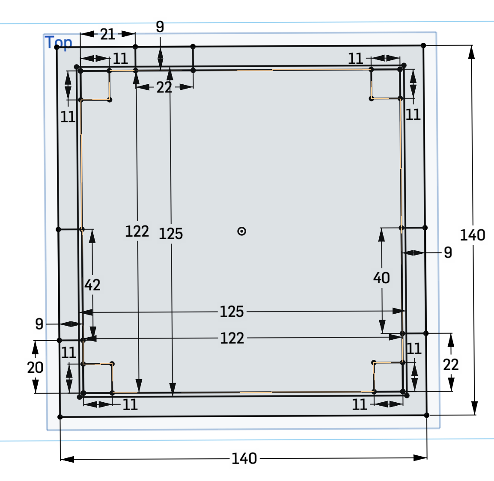
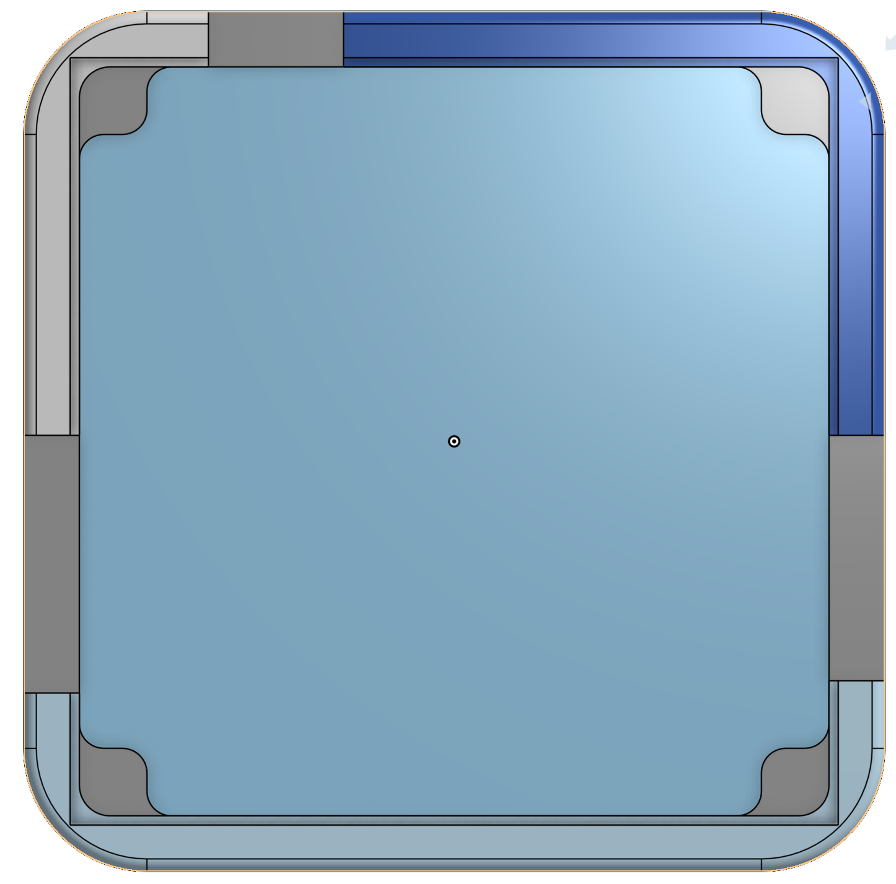
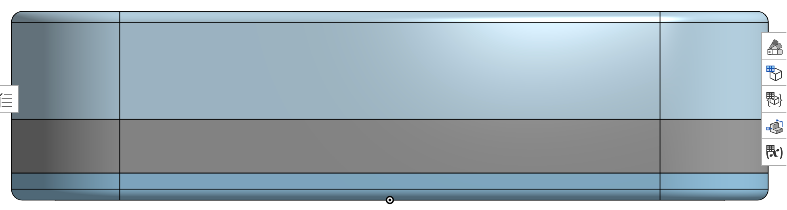
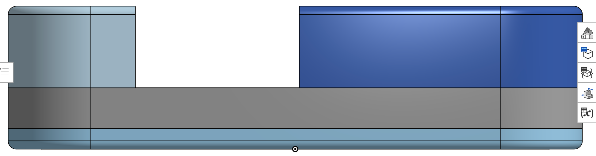
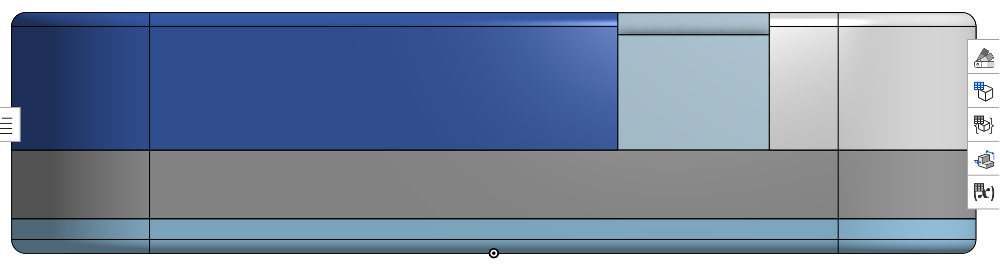
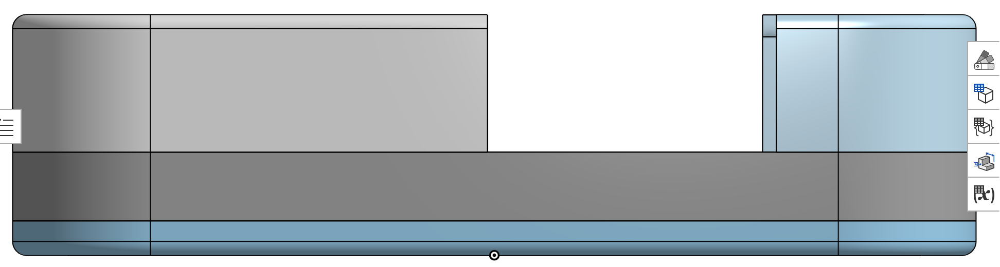
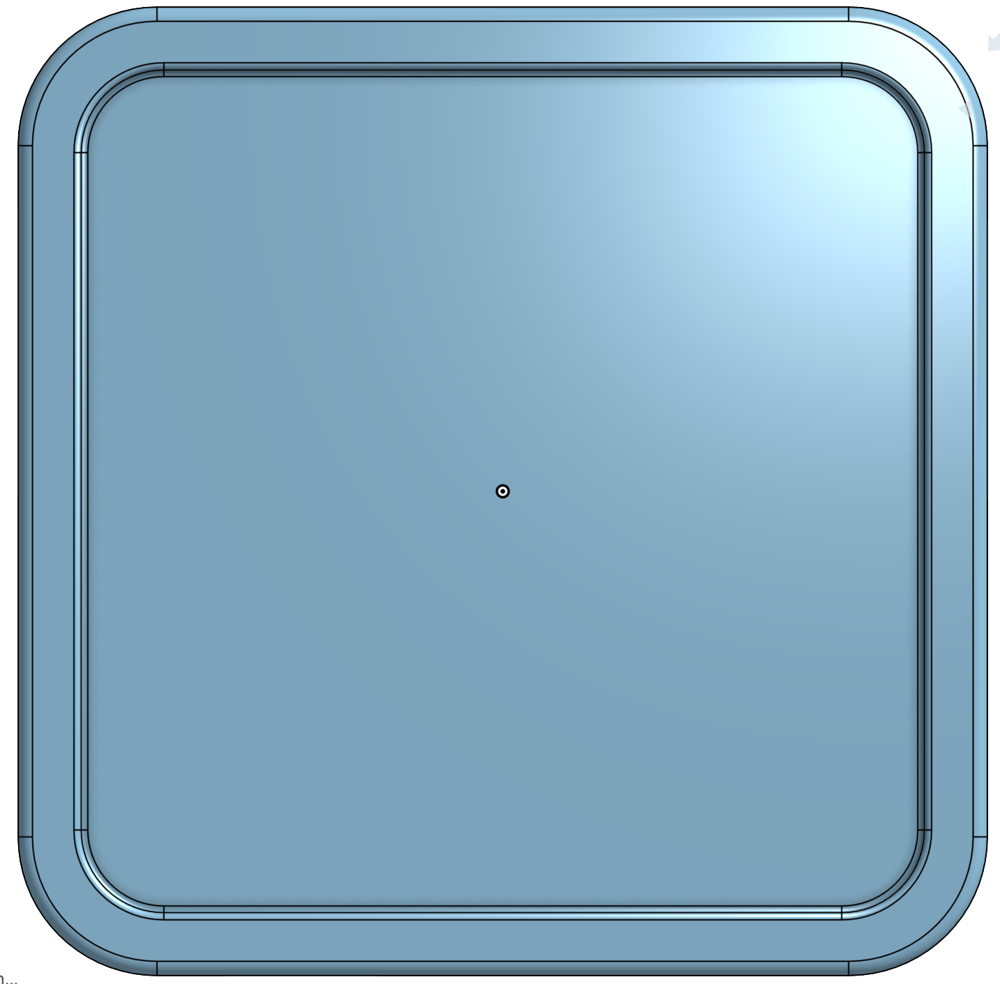

# Chassis CAD gallery

[Back to project](../../README.md)

Onshape captures of the RAVEN chassis, supplied November 19, 2026. The model includes a base, corner supports, segmented walls for connector access, a lid-frame ledge and rounded edges.

One prototype print is queued at The Hive Makerspace: `part_chassis`, Revision 2, black PLA on a Bambu Lab P1S. Print completion and physical PCB/connector fit remain pending. These screenshots document CAD geometry; native CAD and print files are not included.

## Dimensioned base sketch

Outer boundary 140 by 140, inner references 122 and 125, corner features 11 by 11, and access-opening offsets as displayed. Units are not shown in this capture.

## Top view

Rounded enclosure outline, four corner supports, lid-frame ledge and three access gaps.

## Solid-wall elevation

Uninterrupted wall above the lower perimeter and base, with rounded exterior edges.

## Access-side elevation

Opening left of center above the continuous lower perimeter.

## Alternate side elevation

Wall segments and a recessed region toward the right, with background geometry visible in projection.

## Opposite access-side elevation

Opening right of center above the lower perimeter and base.

## Bottom view

Recessed underside surrounded by a rounded support rim and filleted inner boundary.

Original PNGs are preserved unchanged. [Source manifest and SHA-256 hashes](manifest.json).
